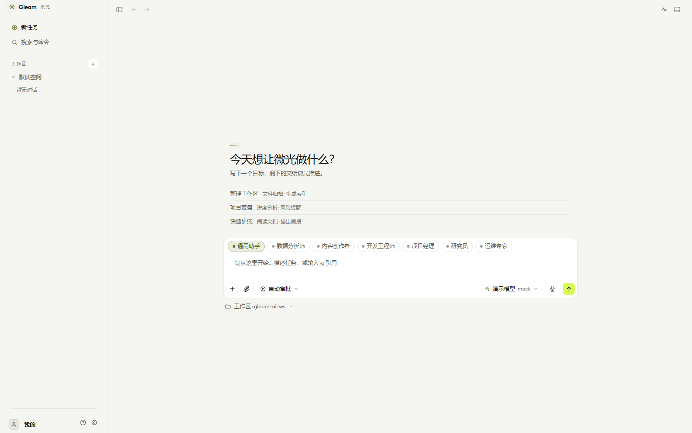

<div align="center">

<picture>
  <source media="(prefers-color-scheme: dark)" srcset="website/favicon.svg">
  
</picture>

# Gleam 微光

**Your local-first AI agent — plans, executes, reflects, and controls your desktop.**

[](https://github.com/gleam-ai/Gleam/releases)
[](LICENSE)
[](https://go.dev/)

[Download v0.0.29](https://github.com/gleam-ai/Gleam/releases/latest) · [Website](https://gleam.wangjn.top) · [Docs](docs/)

</div>

---

Gleam is not a chatbot. It's an agent that **plans tasks, executes them with tools, reflects on the results**, and now **controls your desktop** — all while keeping your data local.

Built from scratch in Go with **zero third-party dependencies**, the core is a single **~10 MB** binary. The desktop shell (Electron) wraps it into a double-click installer with bundled Node and uv runtimes.



## What's new in v0.0.27

- **Electron 45.2.1**: Chromium 156 and current runtime security fixes without relaxing the sandbox
- **Reliable updater startup**: IPC handlers register before page load; development mode reports status without contacting the release feed
- **Dependabot unblocked**: minimatch 11.0.1 removes the vulnerable dependency path, with zero root npm audit findings

## What's new in v0.0.29

- **Full access actually means full access**: medium-risk tools without a path to inspect (`agent.delegate`, `web.fetch`) no longer ask for approval in `mode=auto`; high-risk tools still do, and an explicit per-tool override still wins
- **Final replies stop disappearing**: `reply.text` sent as a paragraph list or a wrapper object is flattened by a new `ArgNormalizer` hook before validation, instead of failing the type check
- **Bot-check pages are no longer treated as content**: `web.fetch` recognizes WeChat and Cloudflare interstitials and fails with an actionable message instead of handing the challenge page to the model
- **Permission menu confirmation fixed**: "auto approve" no longer triggers the "switching to full access" warning

## What's new in v0.0.28

- **原生 SKILL.md 指导技能**：自动发现工作区 `.gleam/skills`、`.agents/skills` 与 `<name>/SKILL.md`，`skill.open` 实现渐进披露（先摘要、按需打开全文）
- **真子任务委派**：`agent.delegate mode=task` —— 先规划（步数封顶 6）、经安全门禁真实调用工具、再汇总返回；原 answer 模式保持不变
- **会话全文检索**：`session.search` 与 `GET /api/conversations/search`，多词 AND、大小写不敏感、上下文片段定位，刻意不建索引
- **工具生命周期钩子**：`safety.hooks` 的 `pre_tool`/`post_tool`，exit 2 阻断工具调用、其余仅告警，主任务 / 技能 / 子任务三条路径全部生效
- **桌面自动化与文生图**：CUA 桌面自动化（direct / powershell / MCP / mock 四种后端）、`image.generate` 文生图（OpenAI 兼容端点）
- **修复**：配置分层优先级（环境变量与 CLI 标志不再被覆盖层冲掉）、Windows 截屏恒败、模型配置绑定与三协议一致性

## What you get

- **Plan → Execute → Reflect** — DAG-based task execution with 0–100 scoring and automatic replanning on low scores
- **Desktop Control (CUA)** — Natural language control of Chrome, WeChat, VSCode via Windows UI Automation
- **Local-first** — conversations, memory, tasks, and audit logs stay on your machine by default
- **9 LLM providers** — GLM, DeepSeek, Kimi, Qwen, OpenAI, Anthropic, OpenRouter, and more, with multi-model tier routing
- **34 built-in tools** — file, shell, web, git, desktop integration, memory, scheduling — plus MCP for unlimited extensions
- **7 expert roles** — analyst, engineer, PM, researcher, ops, creator, or bring your own
- **Skill system** — successful executions crystallize into reusable, versioned skills with success-rate tracking
- **Token efficient** — compact schemas, exponential backoff, role prompt optimization: **55% less token usage**

## Quick start

**Windows (recommended):** Download `Gleam-Setup.exe` from [Releases](https://github.com/gleam-ai/Gleam/releases/latest) — one-click install, no setup needed.

**CLI (all platforms):**

```bash
# Download from releases, then:
./gleam app                                    # Desktop window with CUA
./gleam goal "organize my markdown files"      # Run a task
./gleam goal "open chrome and visit github.com"  # Computer automation!
./gleam goal "summarize this repo" --mock-llm  # Offline demo, no API key
```

Connect a real model by setting your API key in the settings page or via environment variable:

```bash
export GLEAM_API_KEY=your-key
./gleam goal "list and summarize recent git changes"
```

## Architecture

```
cmd/gleam/          CLI entry points (app / serve / goal / webui / desktop-sidecar)
internal/agent/     Plan-Execute-Reflect engine + CUA adapter
internal/tools/     File, shell, web, git, desktop, MCP client
internal/cua/       Computer Use Automation (adapter, router, safety)
internal/llm/       Multi-protocol client (OpenAI Chat / Responses / Anthropic)
internal/webui/     HTTP REST + SSE + embedded frontend (i18n)
internal/harness/   Memory, safety gate, scheduler, skills, worktrees
desktop/            Electron shell (tray, auto-update, bundled runtimes)
vscode-gleam/       VS Code extension with CUA support
```

## Local HTTP API

The desktop window and the CLI drive the embedded web UI over a local HTTP API (bound to `127.0.0.1`, token-gated). This list is the **owner of user-visible endpoints**: `scripts/check-api-docs.py` fails the build when a route is registered in `internal/webui` but missing here — or listed here but not registered.

<details>
<summary>All 106 endpoints</summary>

- **Account** — `/api/account` · `/api/account/configure` · `/api/account/oauth` · `/api/account/signin` · `/api/account/signout` · `/api/account/signup`
- **Approvals** — `/api/approvals` · `/api/approvals/{id}`
- **Connections** — `/api/connections`
- **Context** — `/api/context` · `/api/context/clear` · `/api/context/compress`
- **Conversations** — `/api/conversation/reset` · `/api/conversations` · `/api/conversations/{id}` · `/api/conversations/{id}/activate` · `/api/conversations/search`
- **Cues** — `/api/cues` · `/api/cues/{id}/adopt` · `/api/cues/{id}/dismiss` · `/api/cues/unsuppress`
- **Daemon** — `/api/daemon`
- **Events (SSE)** — `/api/events`
- **Feedback** — `/api/feedback` · `/api/feedback/{id}` · `/api/feedback/{id}/resend` · `/api/feedback/attachment` · `/api/feedback/context`
- **Files** — `/api/fs`
- **Geo** — `/api/geo` · `/api/geo/analyze` · `/api/geo/history`
- **Goals** — `/api/goals` · `/api/goals/{id}` · `/api/goals/{id}/cancel` · `/api/goals/{id}/diff` · `/api/goals/{id}/revert`
- **CLI status** — `/api/go-status` · `/api/go-status/install`
- **Growth** — `/api/growth` · `/api/growth/recent`
- **Hardware** — `/api/hardware/configure-wifi` · `/api/hardware/connect` · `/api/hardware/devices` · `/api/hardware/disconnect` · `/api/hardware/info/{id}` · `/api/hardware/instances` · `/api/hardware/receive` · `/api/hardware/scan-wifi` · `/api/hardware/send`
- **Hooks** — `/api/hooks/{name}`
- **Heartbeat** — `/api/heartbeat`
- **Import** — `/api/import/apply` · `/api/import/scan`
- **Info** — `/api/info`
- **LLM** — `/api/llm/models` · `/api/llm/test`
- **Local data** — `/api/local-data`
- **Market** — `/api/market/mcp` · `/api/market/mcp/install` · `/api/market/runtimes` · `/api/market/skills` · `/api/market/skills/install` · `/api/market/sources`
- **MCP** — `/api/mcp` · `/api/mcp/{name}` · `/api/mcp/{name}/enabled` · `/api/mcp/{name}/reconnect`
- **Memory** — `/api/memory` · `/api/memory/{id}`
- **Models** — `/api/models` · `/api/models/{id}` · `/api/models/{id}/activate` · `/api/models/{id}/default`
- **Network** — `/api/network`
- **Onboarding** — `/api/onboarding`
- **Providers** — `/api/providers`
- **Questions** — `/api/questions/{id}`
- **Readiness** — `/api/readiness`
- **Roles** — `/api/roles`
- **Schedules** — `/api/schedules` · `/api/schedules/{name}` · `/api/schedules/{name}/enabled` · `/api/schedules/{name}/notify`
- **Security** — `/api/security/audit`
- **Settings** — `/api/settings`
- **Show window** — `/api/show-window`
- **Skills** — `/api/skills` · `/api/skills/{name}` · `/api/skills/{name}/enabled` · `/api/skills/{name}/run`
- **Spaces** — `/api/spaces` · `/api/spaces/{id}` · `/api/spaces/{id}/activate`
- **SSH** — `/api/ssh/hosts`
- **Tools** — `/api/tools` · `/api/tools/call` · `/api/tools/permission`
- **Todos** — `/api/todos/{task_id}`
- **Update** — `/api/update/apply` · `/api/update/check` · `/api/update/desktop/{name}`
- **Workspace** — `/api/workspace` · `/api/workspace/clear`
- **Worktrees** — `/api/worktrees` · `/api/worktrees/{id}`

</details>

## Platform support

| Platform | Format | Notes |
|----------|--------|-------|
| **Windows** | NSIS installer (~127 MB) | Bundled Node + uv, tray icon, auto-update |
| **Windows / macOS / Linux** | Single binary (~10–16 MB) | CLI + embedded web UI |

Unsigned binaries — macOS Gatekeeper and Windows SmartScreen will prompt once on first run.

## Contributing

PRs welcome. See [CONTRIBUTING.md](CONTRIBUTING.md) for commit conventions and local dev setup.

## License

[MIT](LICENSE) · Built with Go, running locally.
