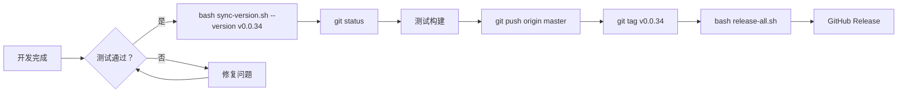

# 版本号同步系统 🔄

## 快速开始

### 最简单的用法（推荐）

```bash
cd /d/PersonalProject/Gleam

# 方式 1: 自动递增版本并同步所有位置
bash scripts/sync-version.sh --version v0.0.34 --commit --push

# 方式 2: 模拟运行，先查看效果
bash scripts/sync-version.sh --version v0.0.34 --dry-run

# 方式 3: 仅更新文件，暂不提交 Git
bash scripts/sync-version.sh --version v0.0.34 --no-commit
```

---

## ✨ 功能特性

### 自动检测并更新以下文件：

#### 🎯 核心文件（必须更新）
- ✅ `pkg/buildinfo/version.go` - Go 代码中的版本常量
- ✅ `README.md` - GitHub README 主文档
- ✅ `CHANGELOG.md` - 变更日志

#### 📝 项目文档
- ✅ `docs/RELEASE-NOTES.md` - Release 详细说明
- ✅ `DESCRIPTION.md` - 项目描述文件（如果存在）
- ✅ `.github/RELEASE-TEMPLATE.md` - Release 模板

#### 💻 桌面应用配置
- ✅ `electron-builder.json` (如果存在)
- ✅ `vscode-gleam/package.json` (如果存在)
- ✅ `desktop/package.json` (如果存在)

#### 🐳 DevOps 配置
- ✅ `Dockerfile` - Docker 镜像标签
- ✅ `docker-compose.yml` - Compose 服务版本
- ✅ `.github/workflows/*.yml` - CI/CD 工作流

---

## 🛠️ 详细使用说明

### 场景 1: 标准发布流程

```bash
# Step 1: 同步版本号到所有位置
bash scripts/sync-version.sh --version v0.0.34

# Step 2: 验证更改
git status
git diff

# Step 3: 测试构建
go build ./cmd/gleam
go test ./...

# Step 4: 推送所有更改
git add .
git commit -m "chore(release): v0.0.34"
git push origin master

# Step 5: 创建并推送 tag
git tag v0.0.34
git push origin v0.0.34

# Step 6: 一键构建并发布
bash scripts/release-all.sh --version v0.0.34
```

### 场景 2: 批量补丁修复（PATCH only）

```bash
# 假设当前版本是 v0.0.33，需要升级到 v0.0.34
# 可以使用自动递增功能

# 先确认当前最新版本
git describe --tags --abbrev=0  # 输出：v0.0.33

# 让脚本自动生成下一个 PATCH 版本
bash scripts/sync-version.sh --version v0.0.34 --commit --push
```

### 场景 3: 紧急热修复（Hotfix）

```bash
# 从 master 分支切出热修复分支
git checkout master
git pull origin master
git checkout -b hotfix/critical-fix

# 同步版本号（带 -hotfix 后缀）
bash scripts/sync-version.sh --version v0.0.33-hotfix.1

# 应用紧急修复
# ... 修改代码 ...

# 提交并合并回 master
git commit -m "fix(critical): emergency patch"
git merge master
git push origin hotfix/critical-fix
```

### 场景 4: 本地开发验证

```bash
# 仅查看将要修改的文件和内容
bash scripts/sync-version.sh --version v0.0.34 --dry-run

# 输出示例：
# ━━━━━━━━━━━━━━━━━━━━━━━━━━━━━━━━━━━━━━━━
# ★ 📦 版本验证与标准化
# ━━━━━━━━━━━━━━━━━━━━━━━━━━━━━━━━━━━━━━━━
# [INFO] 最终版本：v0.0.34
# 
# ━━━━━━━━━━━━━━━━━━━━━━━━━━━━━━━━━━━━━━━━
# ★ 🔄 开始批量更新版本号
# ━━━━━━━━━━━━━━━━━━━━━━━━━━━━━━━━━━━━━━━━
# [INFO] 处理：pkg/buildinfo/version.go ✓
# [INFO] 处理：README.md ✓
# [INFO] 处理：CHANGELOG.md ✓
# 
# ━━━━━━━━━━━━━━━━━━━━━━━━━━━━━━━━━━━━━━━━
# ⚠️  这是模拟运行！文件尚未修改。
# ━━━━━━━━━━━━━━━━━━━━━━━━━━━━━━━━━━━━━━━━
```

---

## 📋 更新范围详解

### 1. Go 源代码 (`pkg/buildinfo/version.go`)

**原始内容:**
```go
const Version = "v0.0.33"
var BuildTime = "2026-11-08T10:00:00Z"
```

**更新后:**
```go
const Version = "v0.0.34"
var BuildTime = "2026-11-09T12:00:00Z"  # 自动更新时间戳
```

### 2. README.md

**定位到的位置:**
```markdown
# Gleam v0.0.33                    ← 会被更新为 v0.0.34
[](↓)
[](↓)
```

**更新规则:**
- 标题中的版本号
- 下载链接中的版本参数
- 徽章上的版本号
- 对比/迁移文档中的参考版本

### 3. CHANGELOG.md

**智能定位:**
```markdown
## v0.0.33                          ← 会被更新为 v0.0.34
Released: 2026-11-08               ← 更新时间
```

### 4. Package Configs

**Electron/Desktop:**
```json
{
  "name": "gleam",
  "version": "0.0.33"              ← 被更新
}
```

**VS Code Extension:**
```json
{
  "version": "0.0.33"              ← 被更新
}
```

### 5. Docker & CI/CD

**Dockerfile:**
```dockerfile
FROM golang:1.22-alpine AS builder
...
CMD ["./gleam", "--version"]       # 镜像会带 v0.0.34 标签
```

**GitHub Actions:**
```yaml
- name: Build and Test
  run: go build -ldflags="-X gleam/pkg/buildinfo.Version=$VERSION"
  env:
    VERSION: ${{ github.ref_name }}  # 自动关联 Tag
```

---

## 🔍 高级功能

### 自定义更新模式

在 `scripts/sync-version.sh` 中定义 `FILES_TO_UPDATE` 数组：

```bash
declare -A FILES_TO_UPDATE=(
  ["custom-file.txt"]="pattern1|pattern2"
)
```

### 跳过某些文件

如果某些文件不需要更新，可以在脚本中添加检查：

```bash
for file in "${!FILES_TO_UPDATE[@]}"; do
  if [[ "$file" == *"skip-me"* ]]; then
    continue  # 跳过特定文件
  fi
  update_file "$file" "${FILES_TO_UPDATE[$file]}"
done
```

### 批量多版本并行处理

```bash
# 示例：同时准备多个版本
versions=("v0.0.34" "v0.0.35" "v0.0.36")

for ver in "${versions[@]}"; do
  echo "Processing $ver..."
  bash scripts/sync-version.sh --version "$ver" --dry-run
  
  # 可以添加其他自动化操作
  # bash scripts/deploy-to-staging.sh --version "$ver"
done
```

---

## 🚨 常见问题排查

### Q: 为什么有些文件没有被更新？

**原因**: 该文件不在预设的更新列表中，或不存在于项目中。

**解决**: 
1. 手动检查该文件是否需要更新
2. 在脚本中添加新的映射关系：

```bash
["your-custom/file.md"]="version|release|tag"
```

### Q: Git commit 失败怎么办？

**错误信息**: `fatal: unable to auto-detect branch list`

**解决方案**:
```bash
# 方法 1: 重新初始化 git
git config user.name "Your Name"
git config user.email "you@example.com"

# 方法 2: 禁用自动提交
bash scripts/sync-version.sh --version v0.0.34 --no-commit
# 然后手动执行：
git add .
git commit -m "chore(release): v0.0.34"
```

### Q: 版本号格式不正确

**错误信息**: `版本号格式无效，必须是 vX.Y.Z 格式`

**支持格式**:
- ✅ `v0.0.34` (推荐)
- ✅ `0.0.34` (会自动添加 'v' 前缀)
- ❌ `0.0.34-beta` (不支持语义化后缀)

**建议**: 始终使用 `v` 前缀，如 `v0.0.34`

### Q: 如何撤销上一次同步？

**方法 1**: Git revert
```bash
git log --oneline | head -5        # 找到 sync-version commit
git revert <commit-hash>
```

**方法 2**: 直接从 HEAD 重置
```bash
git reset --hard HEAD~1           # 谨慎使用！
```

---

## 📊 完整工作流程

### 标准发布周期



---

## 🎓 最佳实践

### 1. 版本策略遵循

使用 **语义化版本号 (SemVer)**:
```
MAJOR.MINOR.PATCH
0.0.34

↑     ↑     ↑
主版本 次版本 修订号

• MAJOR: 重大不兼容 API 变更
• MINOR: 向后兼容的新功能  
• PATCH: Bug 修复
```

### 2. 预发布版本命名

```bash
# Alpha/Beta/RC 版本
v0.0.34-alpha.1
v0.0.34-beta.1
v0.0.34-rc.1

# 热修复版本
v0.0.33-hotfix.1
v0.0.33-hotfix.2
```

### 3. 团队协作规范

```bash
# 负责人 A: 创建版本
bash scripts/sync-version.sh --version v0.0.34 --commit

# 负责人 B: 审查更改
git diff v0.0.33..HEAD

# 所有人：推送并创建 tag
git push origin master --follow-tags
```

### 4. 安全注意事项

- ✅ 永远不要在公共仓库保存包含真实 Token 的脚本
- ✅ 使用 GitHub Secrets 管理敏感信息
- ✅ 定期 review `sync-version.sh` 的权限设置
- ✅ 备份重要的 Git tags

---

## 📞 技术支持

遇到问题？

1. 查看详细文档：`scripts/README-RELEASE.md`
2. 搜索 Issues: https://github.com/GoodTime-AI/Gleam/issues
3. 创建新 Issue 时附上：
   ```bash
   bash scripts/sync-version.sh --version X.X.X --dry-run 2>&1
   ```

---

## 📜 历史

- **2026-11-09**: 初始版本，支持全链路同步
- **未来计划**: 集成到 GitHub Actions 实现完全自动化

---

**Built with ❤️ for seamless version management**
